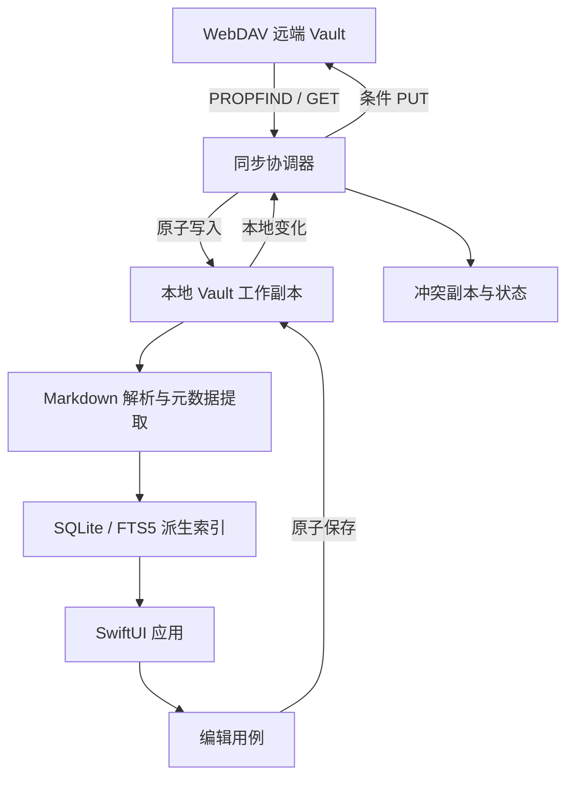

# BearObs 技术路线

> 文档状态：已确认基线
> 版本：1.0
> 日期：2026-07-28

## 1. 目标与边界

本文把 [产品需求文档](01-product-requirements.md) 转换为可演进的技术路线。它回答三个问题：

1. 系统由哪些能力组成；
2. 数据如何安全流动；
3. 哪些能力按什么顺序落地。

技术路线不把 MVVM 当成完整架构，也不把 WebDAV 当成数据模型。真正的系统骨架是本地工作副本、同步基线、显式冲突和可重建索引。

## 2. 三个前提判断

1. **这是真问题**：桌面端编辑体验与开放 Vault 兼容之间存在真实缺口。
2. **最简单可行方案**：不建设业务云后端，采用本地优先工作副本和 WebDAV 文件同步。
3. **最大破坏风险**：错误删除、并发覆盖、路径越界和全文重写。所有写路径都必须晚于只读纵切和同步决策验证。

## 3. 架构原则

- Vault 文件是内容事实源。
- 本地工作副本是离线操作对象，不是私有格式。
- `index.sqlite` 是派生索引，可随时删除重建。
- 同步账本是协调状态，与内容索引物理隔离，不拥有笔记内容。
- 收藏是本机用户状态，与 Vault 和索引隔离。
- 同步决策是纯逻辑；网络、文件系统和数据库只是适配器。
- 所有写入先本地原子落盘，再尝试远端条件上传。
- 不用后台任务承诺实时性。
- 依赖少而明确；只有标准库明显不足时才引入第三方包。

## 4. 四类架构视图

### 4.1 业务架构

业务链路只有一个核心闭环：

```text
连接 Vault
  -> 获取本地可用副本
  -> 浏览 / 分类 / 搜索 / 阅读
  -> 编辑已有笔记
  -> 安全同步
  -> 必要时解决冲突
```

业务能力域：

| 能力域 | 业务职责 | MVP 结果 |
|---|---|---|
| Vault 接入 | 建立用户与远端目录的连接 | 可验证、可撤销的连接配置 |
| 内容消费 | 列表、标签、搜索、阅读、链接跳转 | 断网仍可使用 |
| 内容编辑 | 修改已有 Markdown | 本地原子保存 |
| 内容同步 | 拉取、上传、删除接收、状态恢复 | 无静默覆盖 |
| 冲突治理 | 识别、保留、呈现和解决冲突 | 双方内容均可恢复 |
| 本机偏好 | 收藏、缓存管理 | 不污染 Vault |

### 4.2 应用架构

应用架构不是界面层。BearObs 由以下应用域、模块、服务和接口承载业务能力：

| 应用域 | 主要模块 | 对外接口 | 承载能力 |
|---|---|---|---|
| macOS 前台应用 | Onboarding、Library、Tags、Search、Reader、Editor、Conflicts、Settings | SwiftUI + AppKit 路由与用户操作 | 连接、浏览、阅读、编辑、冲突处理 |
| 应用服务 | VaultUseCases、SearchUseCases、EditUseCases、SyncCoordinator | 用例协议 | 编排业务流程 |
| 内容服务 | MarkdownParser、MetadataExtractor、LinkResolver、Renderer | 解析和渲染协议 | 标签、链接、阅读 |
| 数据服务 | VaultRepository、IndexRepository、UserStateRepository、SyncLedgerRepository | 仓储协议 | 文件、索引、偏好和协调状态 |
| 集成服务 | WebDAVClient、CredentialStore、SyncScheduler | 端口协议 | 远端、Keychain、调度 |
| 平台支撑 | Logging、Metrics、Clock、FileCoordinator、Reachability | 基础能力接口 | 可观测性、并发、测试替身 |

“能力中心”如果后续出现，应作为这些应用域中的建设包，而不是独立于应用架构的另一套体系。例如“同步能力中心”映射到
`SyncCoordinator`、同步决策器、WebDAV 适配器、同步账本和冲突界面。

### 4.3 数据架构

核心数据对象与事实来源：

| 数据对象 | 事实来源 | 本地载体 | 可否重建 |
|---|---|---|---|
| Markdown 内容 | 远端 Vault 与用户本地未同步编辑 | 本地 Vault 工作副本 | 不能从索引重建 |
| 附件内容 | 远端 Vault | 按需缓存 | 可以重新下载 |
| 笔记索引 | 本地工作副本 | `index.sqlite` | 可以 |
| 同步基线与运行状态 | 最近一次成功同步 | 独立 `sync.sqlite` | 可保守重建，但不得据此自动写远端 |
| 冲突副本 | 冲突发生时的本地和远端内容 | 冲突目录 | 解决前不能删除 |
| 收藏 | 用户本机操作 | 独立用户状态 | 不能从 Vault 推导，但不影响内容 |
| WebDAV 凭据 | 用户输入 | Keychain | 需用户重新输入 |

数据流：



### 4.4 技术架构

| 层面 | 技术路线 |
|---|---|
| 客户端 | Swift、SwiftUI、AppKit、macOS 15+；Mac 为首发平台，iOS 客户端后续复用核心模块 |
| 并发 | Swift Concurrency；可变共享状态由 actor 或串行数据库写入边界管理 |
| 网络 | `URLSession`、`XMLParser` 和 RFC 4918 子集 |
| 数据库 | GRDB 7.x、SQLite、FTS5、显式迁移 |
| Markdown | `swift-markdown` AST 处理标准 Markdown；Obsidian 扩展由独立扫描器处理 |
| Frontmatter | YAML 解析器只读取元数据；编辑保存不通过 YAML 序列化器重写全文 |
| 凭据 | macOS Keychain |
| 文件 | Application Support 下的工作副本、临时写入和原子替换 |
| Mac Vault 访问 | 通过 NSOpenPanel 选择 Vault；沙盒构建使用 security-scoped bookmark，工作副本和 staging 仍保持路径边界 |
| 后台 | 首发不依赖系统后台任务；仅保留可取消的前台调度接口 |
| 测试 | Swift Testing 或 XCTest、macOS UI 自动化、可控 WebDAV 测试服务器 |
| 发布 | Xcode Cloud 或等价 CI、Mac Beta/签名与公证、崩溃和性能指标 |

当前文档核验的依赖能力：

- M0-07 已验证并精确锁定 GRDB 7.11.1：显式 migration、原生 async read/write、FTS5
  `unicode61` 和 macOS 交叉编译均通过；正式 `index.sqlite` schema 仍由 M1-B1 建立。
- M0-08 已验证并精确锁定 `swift-markdown` 0.8.0 与 Yams 6.2.2：标准 Markdown AST、
  `SourceRange`、只读 Frontmatter、Obsidian 扩展扫描、诊断渲染和 macOS 交叉编译均通过；
  正式 parser、链接解析和原生 Reader 仍由 M1-A2～M1-A5、M1-C4 建立。
- M0-09 已验证已有文件的 POSIX 原子替换：稳定父目录 descriptor、同目录 exclusive staging、
  完整写入、`fsync`、mode 保留、inode 核对、单次 `rename`、父目录同步和重读校验；提交前、
  提交后未确认耐久性、已持久化但校验失败必须使用不同状态，正式 VaultPath、内容级并发
  前置条件和编辑编排仍由 M0-10、M3 建立。
- M0-10 已冻结第一版纯领域契约：`VaultPath` 区分已解码路径与只解码一次的远端编码路径，
  `SyncPlanner` 区分已跟踪、首次导入和保守恢复，所有下载、上传和本地移除计划携带执行前
  CAS 条件；强 ETag 从完整响应头解析，弱、列表、通配符或缺失写前置条件绝不产生 upload；
  远端内容身份与当前写保护条件分离，统一错误只保存白名单结构诊断。

不在路线中引入：

- 业务后端；
- 跨平台 UI 框架；
- 私有 Markdown 方言；
- 依赖远端 hash 的同步算法；
- 把整套 App 状态塞进单一 MVVM ViewModel。

## 5. 目标系统形态

```text
BearObsApp
├── Presentation
│   ├── Onboarding
│   ├── Library
│   ├── Search
│   ├── Reader
│   ├── Editor
│   ├── Conflicts
│   └── Settings
├── Application
│   ├── Vault
│   ├── Search
│   ├── Editing
│   └── Sync
├── Domain
│   ├── Note
│   ├── VaultPath
│   ├── SyncDecision
│   └── Conflict
└── Infrastructure
    ├── LocalVault
    ├── Markdown
    ├── Index
    ├── WebDAV
    ├── Keychain
    └── Observability
```

首版保持一个 App target 和少量清楚的边界。只有当编译隔离、复用或测试速度给出真实收益时，才把 Domain、Sync 或 Markdown 拆成独立 Swift Package。不要为“架构感”提前制造十几个包。

## 6. 同步技术路线

### 6.1 变化信号

远端：

- 规范化相对路径；
- `ETag`，若服务提供；
- `Last-Modified`；
- `Content-Length`；
- 资源类型。

本地：

- 规范化相对路径；
- 文件内容 SHA-256；
- 文件大小；
- 本地修改时间仅作扫描优化，不作为最终一致性证据。

基线：

- 上次成功同步时的本地 hash；
- 上次成功同步时的远端 validator；
- 最近同步结果。

### 6.2 决策矩阵

| 本地相对基线 | 远端相对基线 | 行为 |
|---|---|---|
| 未变 | 未变 | 无操作 |
| 未变 | 已变 | 下载并原子替换 |
| 已变 | 未变 | 条件上传 |
| 已变 | 已变 | 创建冲突，禁止覆盖 |
| 未变 | 已删除 | 删除本地副本并清理派生索引 |
| 已变 | 已删除 | 创建“本地修改 / 远端删除”冲突 |
| 新建 | 不存在 | MVP 不由 App 创建；仅用于恢复和冲突逻辑 |
| 不存在 | 新建 | 下载 |

### 6.3 条件写

- 更新已有文件优先使用 `If-Match: <etag>`。
- 若没有可靠 ETag，使用认证服务验证过的替代策略；不能验证时降级为冲突而不是盲写。
- HTTP `412 Precondition Failed` 必须转换为冲突。
- 上传成功后重新获取远端 validator，再提交新基线。

### 6.4 删除与重命名

- MVP 不从 App 发起远端 `DELETE` 或 `MOVE`。
- 远端删除只在本地未修改时应用。
- 远端重命名视为旧路径删除和新路径新增。
- MVP 以规范化相对路径作为文件身份，不使用不可靠的自动重命名推断。

## 7. Markdown 技术路线

解析分两层：

1. 标准 Markdown 由 `swift-markdown` 构建 AST，用于阅读渲染和结构遍历。
2. Obsidian 扩展由保留源码位置的扫描器处理，包括 Frontmatter、Inline Tag、Wiki Link 和 Embed。

关键约束：

- 解析器返回不可变值；
- 元数据提取不修改原文；
- 代码块和行内代码排除在标签和 Wiki Link 扫描之外；
- 不支持语法以原文降级；
- 编辑器直接编辑原始 Markdown，不把 AST 序列化回全文；
- title 优先级统一为 Frontmatter `title`、首个 H1、文件名。

## 8. 索引技术路线

`index.sqlite` 只保存可派生数据：

- notes；
- tags；
- note_tags；
- links；
- attachments；
- FTS5 全文索引。

策略：

- 使用 GRDB migrations 管理 schema；
- 单文件解析结果在单事务内替换；
- 文件 hash 未变化时跳过解析；
- 删除文件时通过外键或显式事务清理关系；
- 索引损坏直接重建，不写复杂修复器；
- 普通 FTS5 使用 `unicode61`；M1 中文语料实测中，裸 `unicode61` 对 6 个自然查询仅召回
  2 个，因此增加独立的汉字 unigram+bigram FTS，实测召回提升到 6/6；2 个负向查询未出现
  测得误匹配，10,000 篇查询 P95 0.808 毫秒，FTS 页占用约为普通表的 3.44 倍。两张 FTS 表
  均为可重建派生数据，并与关系索引同事务更新；详见 ADR-008。

## 9. 安全路线

### M0 起必须成立

- 凭据不进入源码、UserDefaults 和日志；
- 路径规范化与 Vault 根目录约束有单元测试；
- 日志默认脱敏；
- 依赖版本锁定；
- 测试 fixture 不含真实用户内容。

### 写路径开放前必须成立

- 本地原子写和崩溃恢复测试通过；
- 条件 PUT 契约测试通过；
- 双边修改全部进入冲突；
- 冲突副本有生命周期保护；
- 安全审查 Critical/High 为 0。

## 10. 可观测性路线

记录结构化、无正文的事件：

- 同步运行 ID；
- 阶段、耗时和文件计数；
- 状态码和错误类别；
- 路径使用不可逆摘要或受控相对路径；
- 重试次数；
- 索引数量和耗时；
- 冲突数量。

不记录：

- 密码、认证头和完整服务 URL 中的敏感参数；
- Markdown 正文；
- 附件内容；
- 未经用户同意的远端诊断数据。

## 11. 阶段路线

### M0 工程与风险 Spike

目标：证明技术边界可行。

- 建立独立 Git 仓库和 macOS 15 工程；
- 建立 CI、测试 target、格式化和安全基线；
- 验证 GRDB FTS5、`swift-markdown`、原子文件替换；
- 建立 Golden Vault 和 WebDAV fixture；
- 冻结路径、同步状态和错误模型；
- 选定首个真实 WebDAV 认证服务。

### M1 Mac 本地只读纵切

目标：不联网完成有用产品闭环。

- 本地 Vault 枚举；
- Markdown 解析；
- 增量索引；
- 列表、标签、搜索、阅读、Wiki Link 和收藏；
- 索引重建与性能基线。

### M2 Mac WebDAV 拉取技术预览

目标：得到可靠的离线工作副本。

- HTTPS 连接与 Keychain；
- PROPFIND/GET；
- 首次与增量拉取；
- 远端新增、修改、删除和重命名接收；
- 按需附件缓存；
- 前台触发和可恢复错误；
- RFC fixture 与首个真实服务契约测试。

### M3 Mac 编辑与条件上传

目标：安全开放写路径。

- 编辑已有 Markdown；
- 原子本地保存；
- 待同步状态；
- 三方决策；
- 条件 PUT；
- 网络失败重试；
- 无冲突编辑闭环。

### M4 Mac 冲突与发布加固

目标：满足对外 MVP 发布标准。

- 冲突保留双方；
- 冲突列表和解决流程；
- 故障注入；
- 性能、辅助功能和隐私；
- Mac Beta/签名与公证验收；
- 安全与兼容性审查。

### M5 iOS 客户端与后续能力

- App 内创建、删除和重命名；
- iOS 原生客户端，复用 M0-M4 的 Domain、Markdown、Index 和 Sync 模块；
- 跨设备收藏；
- Backlinks、Daily Note 和快捷创建；
- 更多 WebDAV 认证服务；
- 高级 Obsidian 语法；
- AI 能力。

M5 不得反向污染 M0-M4 的范围。

## 12. 关键技术决策点

| 决策点 | 截止阶段 | 判断依据 |
|---|---|---|
| 首个 WebDAV 认证服务 | M2 开始前 | 用户实际环境和可自动化测试能力 |
| GRDB 锁定版本 | M0 结束 | macOS 15、当前 Swift 工具链和 FTS5 Spike |
| FTS5 中文检索策略 | M1 结束 | 真实中文 Vault 的召回率和延迟 |
| 自定义 Markdown 渲染范围 | M1 早期 | 标准语法和大文档性能 |
| 无 ETag 服务的写入支持 | M2 结束 | 是否存在可验证的安全条件写策略 |
| 后台同步策略 | M4 | Mac 长时间运行测量，不影响确定性前台同步 |

## 13. 架构风险与反模式

必须避免：

- 把 `modified_time` 当作唯一同步依据；
- 远端和本地都变更时“最后写入获胜”；
- 用 Markdown AST 序列化器重写整篇用户文件；
- 将同步、索引、导航和所有界面状态塞进一个 ViewModel；
- 把同步账本和可删除索引放在同一重建流程中；
- 递归信任服务返回路径；
- 在 UI 主线程做 Vault 全量扫描和 hash；
- 因为 macOS 支持常驻进程就承诺实时同步；
- 为尚不存在的多人协作、插件或 AI 需求预埋复杂框架。

## 14. 技术完成判定

技术路线完成不以“所有页面能点”为标准，而以以下事实为标准：

1. 内容工作副本、索引、同步账本和本机状态边界清楚；
2. 同步决策可通过纯逻辑测试穷举；
3. 所有写路径具备原子性、条件性和可恢复性；
4. 索引可删除重建；
5. 未支持语法和服务能力会安全降级；
6. 满足 PRD 的数据完整性、性能、安全和测试门槛。
