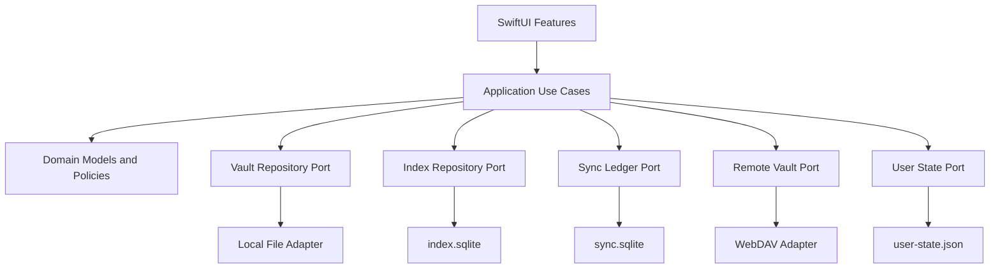
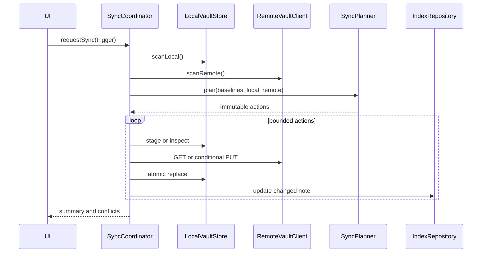

# BearObs 开发设计文档

> 文档状态：已确认基线
> 版本：1.0
> 日期：2026-07-28
> 上游文档：[产品需求](01-product-requirements.md) · [技术路线](02-technical-roadmap.md)

## 1. 设计目标

本设计服务于 macOS 15+ 对外 MVP。首发目标是纳入兼容性测试的 Mac；iOS 客户端在 Mac MVP 稳定后复用核心模块建设。设计重点保证：

- 本地工作副本优先，网络不阻塞内容访问；
- Markdown 和附件保持 Obsidian 兼容；
- 内容索引可删除重建；
- 远端写入有条件保护；
- 双边变化保留双方，不静默覆盖；
- 模块边界可替换、可测试，不把业务规则绑死在 SwiftUI、SQLite 或 WebDAV 上。

## 2. 设计范围

包含：

- Vault 连接和本地目录；
- Markdown 解析、索引、搜索和渲染；
- 笔记列表、标签、阅读、收藏和编辑；
- WebDAV 拉取、条件上传和冲突处理；
- 附件按需缓存；
- 安全、日志、恢复和测试设计。

不包含：

- App 内创建、删除和重命名；
- 完整 Obsidian 插件与语法兼容；
- 跨设备收藏；
- 业务云后端；
- 富文本编辑和 AST 全文回写（原位编辑的编辑即预览由 ADR-009 与 REQ-002 约束）；
- AI 能力。

## 3. 四类架构设计

### 3.1 业务架构

业务过程由六个稳定能力组成：

1. 配置并验证远端 Vault；
2. 建立可离线使用的本地工作副本；
3. 从工作副本派生浏览和搜索能力；
4. 对已有 Markdown 进行本地原子编辑；
5. 根据同步基线安全交换变化；
6. 对无法自动合并的变化进行显式冲突治理。

内容安全优先级高于同步速度，确定行为优先级高于后台自动化。

### 3.2 应用架构



应用层只编排用例；领域层做同步、路径和链接规则；基础设施层实现文件、SQLite、WebDAV 和 Keychain。SwiftUI 不直接操作数据库、文件或网络。

### 3.3 数据架构

数据按所有权和恢复策略拆分：

| 存储 | 内容 | 所有权 | 恢复策略 |
|---|---|---|---|
| `Files/` | Markdown 工作副本 | 用户内容 | 不得由索引覆盖；从远端或未同步本地内容恢复 |
| `Cache/Attachments/` | 已下载附件 | 缓存 | 可删除并从远端重新下载 |
| `Metadata/index.sqlite` | 笔记、标签、链接、FTS | 派生索引 | 从 `Files/` 重建 |
| `Metadata/sync.sqlite` | 基线、运行状态、冲突引用 | 同步协调状态 | 丢失后进入保守重建，禁止直接写远端 |
| `Metadata/user-state.json` | 收藏和本机偏好 | 本机用户状态 | 原子写；不参与索引重建 |
| `Conflicts/` | 本地与远端冲突副本 | 用户待处理内容 | 解决前不可清理 |
| Keychain | WebDAV 凭据 | 敏感配置 | 用户重新输入 |

### 3.4 技术架构

- SwiftUI 提供界面与导航。
- Swift Concurrency 提供结构化并发。
- `@MainActor` 只承载界面状态。
- `SyncCoordinator` 使用 actor 保证每个 Vault 同时只有一个同步运行。
- GRDB 管理 SQLite 迁移、事务、异步访问和 FTS5。
- `swift-markdown` 解析标准 Markdown AST。
- 自定义源码扫描器解析 Obsidian 扩展并保留源码范围。
- `URLSession` 和 `XMLParser` 实现受控 WebDAV 子集。
- Keychain 保存凭据。
- macOS UI 自动化覆盖原生 Mac 关键流程。

## 4. 建议工程结构

```text
BearObs/
├── App/
│   ├── BearObsApp.swift
│   ├── AppEnvironment.swift
│   └── AppRouter.swift
├── Features/
│   ├── Onboarding/
│   ├── Library/
│   ├── Tags/
│   ├── Search/
│   ├── Reader/
│   ├── Editor/
│   ├── Conflicts/
│   └── Settings/
├── Application/
│   ├── Vault/
│   ├── Indexing/
│   ├── Search/
│   ├── Editing/
│   └── Sync/
├── Domain/
│   ├── Notes/
│   ├── Paths/
│   ├── Links/
│   └── Sync/
├── Infrastructure/
│   ├── LocalVault/
│   ├── Markdown/
│   ├── Index/
│   ├── SyncLedger/
│   ├── WebDAV/
│   ├── Keychain/
│   └── Observability/
├── Resources/
└── Tests/
    ├── Unit/
    ├── Integration/
    ├── Contract/
    ├── Performance/
    └── UI/
```

规则：

- 按能力组织，不建立巨型 `Models`、`Services`、`ViewModels` 杂物目录。
- 单个 ViewModel 只负责一个界面或流程，并调用应用用例。
- 文件通常保持 200-400 行，超过 800 行必须拆分。
- 函数通常小于 50 行；出现四层以上嵌套时先重构数据流。
- 领域值优先不可变；状态变化通过返回新值或受控 actor 完成。

## 5. 文件系统布局

```text
Application Support/BearObs/
└── Vaults/
    └── <vault-id>/
        ├── Files/
        │   └── <vault-relative-markdown-path>
        ├── Cache/
        │   └── Attachments/
        │       └── <path-digest>
        ├── Conflicts/
        │   └── <conflict-id>/
        │       ├── local.md
        │       ├── remote.md
        │       └── metadata.json
        ├── Staging/
        └── Metadata/
            ├── index.sqlite
            ├── sync.sqlite
            └── user-state.json
```

约束：

- `vault-id` 是本机生成的稳定标识，不包含凭据。
- 所有 Vault 路径在进入文件系统前转换为 `VaultPath`。
- `VaultPath` 只允许规范化相对路径。
- 拒绝空路径段、绝对路径、NUL、`.`、`..` 和规范化后越界。
- 本地编辑的临时文件必须是目标同目录的唯一 sibling staging，确保单次 `rename` 原子发布；
  顶层 `Staging/` 用于下载等长生命周期 action，不作为本地编辑的跨目录临时文件。
- 冲突目录不属于普通缓存清理范围。

## 6. 核心领域模型

### 6.1 VaultPath

职责：

- 用 `init(decodedRelativePath:)` 接受本地已解码路径，用
  `init(percentEncodedRelativePath:)` 接受 WebDAV 相对编码路径；两种入口禁止混用；
- 百分号输入严格按 UTF-8 只解码一次，字面 `%` 再编码为 `%25`；
- Unicode 身份只做 NFC，区分大小写，不做兼容分解或大小写折叠；
- 唯一分隔符是 `/`；反斜杠直接拒绝，禁止把普通 POSIX 文件名静默改成路径层级；
- 提供父目录、扩展名和文件名；
- 拒绝空路径、绝对路径、空段、NUL、`.`、`..`，以及百分号解码后才形成的分隔符、
  反斜杠或目录穿越；
- 作为 MVP 文件身份。

`VaultPath` 不实现 `RawRepresentable`、字符串字面量或完整 URL 初始化器，避免绕过校验。
Codable 解码必须重新走同一校验入口。WebDAV origin/根路径剥离和 symlink-safe containment
属于适配器与 `LocalVaultStore`，不得塞进这个纯值。各模块不得重复手写字符串拼接和校验。

### 6.2 Note

索引层的不可变读模型：

| 字段 | 说明 |
|---|---|
| `path` | 主键，`VaultPath` |
| `title` | Frontmatter `title`、首个 H1、文件名的统一结果 |
| `preview` | 去除结构标记后的短摘要 |
| `contentHash` | 本地文件 SHA-256 |
| `modifiedAt` | 本地已知修改时间，仅用于排序和扫描优化 |
| `byteSize` | 文件大小 |
| `parseStatus` | 正常、部分降级或失败 |

文件内容不由 `Note` 模型拥有，读取正文时从工作副本获取。

### 6.3 ParsedNote

单次解析产生的不可变结果：

- title；
- preview；
- frontmatter 范围与只读值；
- tags；
- wiki links；
- embeds；
- 标准 Markdown AST 或渲染中间表示；
- 诊断信息；
- 原始编码和换行风格信息。

### 6.4 SyncBaseline

| 字段 | 说明 |
|---|---|
| `localHash` | 上次成功同步后的本地内容 hash |
| `remoteRevision` | 上次成功同步的可靠远端 revision，可空；弱 ETag、Last-Modified 和 size 不得冒充 |

路径是持久层记录的 key，不能同时塞进 baseline value 形成两个事实来源。运行状态与 action
ledger 也不属于基线事实。基线提交只能发生在文件操作和远端 validator 都确认成功之后。

### 6.5 SyncDecision

同步规划器只接受不可变值，不执行 I/O。上下文显式区分三种状态，禁止用 `baseline == nil`
同时表示首次导入和账本丢失：

```text
plan(
  context: tracked(SyncBaselineState) | initialImport | conservativeRecovery,
  local: LocalResourceState,
  remote: RemoteResourceState
) -> SyncDecision
```

可能结果：

- noAction；
- download；
- upload；
- removeLocal；
- establishBaseline；
- conflict；
- unsupported；
- needsConservativeRecovery。

内容 hash 是规范化 SHA-256 hex。`RemoteRevision` 只能由适配器基于已认证的可靠证据构造；
写前置条件与 revision 分开表达，revision 相等性只比较内容身份，写入时使用当前快照的保护
条件。`StrongETag` 必须解析完整单值响应头并拒绝弱 ETag、列表和通配符，再生成 `If-Match`；
没有经过认证的强条件时，即使能检测远端未变，也禁止产生 upload。若远端声称 revision 未变，
但同时提供与基线矛盾的已验证内容 hash，视为不可验证冲突，禁止 noAction 或 upload。

所有可能破坏数据的计划必须携带执行前条件：download 携带 expected-local 与已观察 remote
revision，upload 携带 expected-local-hash 和远端写前置条件，removeLocal 携带
expected-local-hash。执行器发现条件变化时必须停止并重新规划。

无基线时的本地/远端四格为：缺/缺 noAction，缺/有 download，首次导入的有/缺
unsupported(localCreation)，恢复态的有/缺 needsConservativeRecovery；有/有必须先证明内容
hash 相同才能 establishBaseline，不同则 conflict，未知则保守恢复。tracked 3×5 与保守恢复
3×4 必须用表驱动测试逐格锁定精确结果。

### 6.6 Conflict

冲突包含：

- 原始 Vault 路径；
- 冲突类型；
- 本地副本路径和 hash；
- 远端副本路径、ETag 和 hash；
- 创建时间；
- 当前状态；
- 解决选择；
- 解决尝试使用的远端前置条件。

## 7. 端口与适配器

### 7.1 LocalVaultStore

职责：

- 流式枚举 Markdown；
- 读取文件和计算 hash；
- 暂存下载；
- 原子替换；
- 只在已验证未修改时移除本地文件；
- 报告磁盘不足、权限和编码错误。

不负责：

- 同步决策；
- SQL；
- UI 状态；
- WebDAV。

### 7.2 NoteParser

职责：

- 从原始字节解析 UTF-8 Markdown；
- 识别 BOM 和换行风格；
- 提取 Frontmatter、标签、链接和嵌入；
- 构建标准 Markdown AST；
- 返回局部诊断而不是随意抛弃整篇内容。

### 7.3 IndexRepository

职责：

- 执行 schema migration；
- 以单事务替换单篇笔记的全部派生记录；
- 删除路径对应的派生记录；
- 查询列表、标签、链接和 FTS；
- 全量重建。

### 7.4 SyncLedgerRepository

职责：

- 读取和提交同步基线；
- 记录运行和每条 action 的状态；
- 保存冲突元数据引用；
- 在崩溃后识别未完成 action；
- 不保存笔记正文。

### 7.5 RemoteVaultClient

职责：

- 验证连接和能力；
- 按目录列举资源；
- 下载到调用者提供的 staging sink；
- 条件上传；
- 返回结构化远端 validator 和错误。

MVP 不暴露远端删除和移动接口，避免未使用能力进入写路径。

### 7.6 UserStateRepository

职责：

- 原子读写收藏和本机偏好；
- 移除已不存在路径的有效收藏；
- 不访问 Markdown 和同步账本。

## 8. SQLite 设计

### 8.1 `index.sqlite`

建议表：

#### notes

| 列 | 约束 |
|---|---|
| `path` | TEXT PRIMARY KEY |
| `title` | TEXT NOT NULL |
| `preview` | TEXT NOT NULL |
| `content_hash` | TEXT NOT NULL |
| `modified_at` | DOUBLE NOT NULL |
| `byte_size` | INTEGER NOT NULL |
| `parse_status` | TEXT NOT NULL |

#### tags

| 列 | 约束 |
|---|---|
| `normalized_name` | TEXT PRIMARY KEY |
| `display_name` | TEXT NOT NULL |

#### note_tags

- `note_path` 外键到 notes，删除级联；
- `tag_name` 外键到 tags；
- `display_name` 保留该笔记中的原始展示形式，供删除或替换后确定性重算全局标签展示名；
- 复合主键避免重复。

#### links

- `source_path`；
- `raw_target`；
- `alias`；
- `resolved_path` 可空；
- `resolution_state` 为 unresolved、resolved、missing 或 ambiguous；解析前不得把未知目标伪装成 missing。

#### attachments

- `note_path`；
- `raw_target`；
- `resolved_path` 可空；
- `cache_state`。

#### note_fts

FTS5 字段：

- path；
- title；
- body；
- tags。

#### note_diagnostics

- `note_path` 外键到 notes，删除级联；
- `code` 只保存固定结构化解析诊断码，不保存正文或任意错误文本；
- 复合主键避免同一笔记重复诊断。

初始 tokenizer 使用 `unicode61`。中文搜索质量必须用真实语料验收，不能因为“能查到几个词”就宣布完成。

M1 实测后增加 `note_cjk_fts`：英文等非汉字内容仍由 `unicode61` 处理，连续汉字额外生成
unigram 与相邻 bigram，并在纯汉字查询时使用 phrase 匹配守住相邻关系。该表仍是可重建派生数据，
与普通 FTS、关系表在同一事务更新。

### 8.2 `sync.sqlite`

建议表：

- `vaults`：非敏感远端标识、根路径、能力；
- `sync_entries`：每个路径的基线和状态；
- `sync_runs`：运行阶段、计数、结果和脱敏错误；
- `conflicts`：冲突目录引用和解决状态。

关键约束：

- `sync_entries.path` 唯一；
- 基线更新和 action 完成记录在同一事务提交；
- 数据库迁移与 `index.sqlite` 独立；
- “重建索引”绝不能删除或重建 `sync.sqlite`。

## 9. Markdown 解析设计

### 9.1 处理顺序

1. 解码 UTF-8，识别 BOM 和换行；
2. 仅当文件第一行是 `---` 时识别 Frontmatter；
3. 找到闭合分隔符，记录原始范围；
4. 使用 YAML 解析器读取所需字段，不序列化回原文；
5. 使用 `swift-markdown` 解析正文；
6. 收集代码范围；
7. 在排除范围之外扫描 Inline Tag、Wiki Link 和 Embed；
8. 生成不可变 `ParsedNote`；
9. 以事务更新索引。

### 9.2 标题规则

固定优先级：

1. Frontmatter 非空字符串 `title`；
2. 正文首个 ATX H1；
3. 文件名去扩展名。

不使用正文任意首行猜标题，避免列表或代码被误判。

### 9.3 标签规则

- Frontmatter 支持单字符串、逗号分隔字符串和字符串数组；
- Inline Tag 支持 Unicode 字母、数字、连接符、下划线和 `/`；
- 标准化查询名使用 Unicode 规范化和不区分大小写比较；
- 展示名保留首次或最稳定的原始形式；
- 代码、URL 和 HTML 属性中的 `#` 不进入标签。

### 9.4 Wiki Link 规则

支持：

- `[[Note]]`；
- `[[Folder/Note]]`；
- `[[Note|Alias]]`；
- `![[image.png]]`。

解析优先级：

1. 显式 Vault 相对路径精确匹配；
2. 相对源笔记目录匹配；
3. Vault 根目录匹配；
4. 唯一文件名匹配；
5. 多个候选则 ambiguous，不自动跳转。

标题别名和 Obsidian 更复杂的最短路径算法留到后续兼容阶段。

### 9.5 编辑保存

编辑器持有原始 Markdown 文本，不编辑 AST。保存流程：

1. 校验目标仍在 Vault 根目录；
2. 编码为 UTF-8，尽量保留 BOM 和换行风格；
3. 在目标同目录写入唯一 sibling staging；
4. flush 并关闭文件；
5. 原子替换目标；
6. 重新读取并计算 hash；
7. 更新索引；
8. 标记 `localModified`；
9. 触发同步。

任何一步失败都返回结构化错误；基线不得提前更新。

## 10. WebDAV 设计

### 10.1 支持的协议子集

- `PROPFIND`：资源发现和元数据；
- `GET`：Markdown 和附件下载；
- `PUT`：仅更新已有 Markdown；
- `HEAD`：仅在认证服务验证可靠时作优化。

MVP 不从 App 调用 `DELETE`、`MOVE`、`COPY`、`LOCK`。

### 10.2 目录扫描

- 使用 `Depth: 1` 的广度优先扫描，避免服务端 `Depth: infinity` 的兼容和资源风险；
- 正确解析 `207 Multi-Status`；
- 对 XML namespace 和 `propstat` 状态做兼容解析；
- 每个返回 URL 只解码一次并转换为 `VaultPath`；
- 拒绝跨 origin 重定向和越出根目录的响应；
- 默认排除 `.obsidian/`、`.trash/` 和 BearObs 自身保留目录；
- 排除规则集中配置，不散落在扫描代码中。

### 10.3 下载

1. GET 流式写入 Staging；
2. 同步计算 SHA-256；
3. 验证响应状态和可用长度；
4. 再次确认本地状态没有在下载期间改变；
5. 原子替换；
6. 更新索引；
7. 提交新基线。

### 10.4 上传

1. 读取当前本地 hash；
2. 确认与规划时一致；
3. 使用基线 ETag 发出 `If-Match` PUT；
4. `412` 或 validator 不一致转为冲突；
5. 上传成功后重新获取远端 validator；
6. 确认本地在上传期间未再次变化；
7. 若再次变化，保持 `localModified` 并安排下一轮；
8. 否则提交新基线。

### 10.5 认证和 TLS

- 使用 URLSession challenge 与 Keychain 凭据；
- 只接受系统默认信任评估；
- 不提供“忽略证书错误”开关；
- 不在日志中记录认证头、密码和带敏感查询参数的 URL；
- 重定向后必须保持 HTTPS 和允许的 origin。

## 11. 同步执行设计

### 11.1 运行状态机

```text
idle
  -> scanningLocal
  -> scanningRemote
  -> planning
  -> applyingDownloads
  -> applyingUploads
  -> indexing
  -> completed
```

旁路状态：

- waitingForNetwork；
- requiresAuthentication；
- conflictsPresent；
- cancelled；
- failedRecoverable；
- failedTerminal。

状态机是单向事件驱动，不用散布在多个 ViewModel 的布尔值组合表示。

### 11.2 运行流程



### 11.3 并发规则

- 每个 Vault 同时只有一个 `SyncCoordinator` 运行；
- 下载允许小规模有界并发，默认值通过性能测试确定；
- 同一路径的 action 必须串行；
- SQLite 写入通过 GRDB 写事务串行化；
- UI 更新在 `@MainActor`；
- 取消只停止尚未提交的 action，不回滚已成功且已记录的文件；
- 下一次运行从账本识别未完成 action 并安全恢复。

### 11.4 冲突创建

创建冲突时：

1. 冻结当前本地内容到 `local.md`；
2. 下载远端内容到 `remote.md`；
3. 写入 `metadata.json`；
4. 原子提交冲突目录；
5. 在 `sync.sqlite` 记录冲突；
6. 保持正常工作副本不被远端覆盖；
7. 在列表和详情展示冲突状态。

## 12. 搜索与索引设计

### 12.1 增量索引

- 初筛使用路径、大小和修改时间；
- 可疑变化计算 SHA-256；
- hash 不变跳过解析；
- hash 变化时解析并在单事务更新 notes、tags、links、attachments 和 FTS；
- 删除路径在单事务清理派生记录；
- 失败笔记记录诊断并保留可搜索的安全标题。

### 12.2 搜索查询

- 用户输入先做长度和字符规范化；
- 使用参数绑定，不拼接 SQL；
- 标题和标签赋予高于正文的排序权重；
- 返回短摘要，不加载全部匹配正文到内存；
- 空查询走最近笔记查询；
- 查询取消随用户输入更新传播。
- 5 篇中文语料的 6 个正向自然查询中，裸 `unicode61` 召回 2/6；汉字 unigram+bigram FTS
  召回 6/6。加入 2 个负向组合查询后候选策略完整满足 8/8 期望结果且无测得误匹配；10,000 篇
  合成笔记查询 P95 0.808 毫秒，FTS 页占用约为普通表的 3.44 倍。详见 ADR-008。

## 13. UI 与状态设计

### 13.1 主要导航

- Onboarding：连接、验证、首次同步；
- 主工作区使用 macOS 原生 `NavigationSplitView` 固定三栏职责：最左侧主侧边栏负责系统入口和标签树，
  次左侧栏只负责当前条件下的笔记摘要列表，右侧栏只负责选中笔记的 Reader/Editor 或未选择提示；
- 主侧边栏的系统入口为全部笔记、最近、收藏和搜索；标签作为可折叠树直接位于同一侧边栏，不再占用笔记列表栏；
- 标签树显示嵌套层级，但每个可选节点仍以完整 normalized identity 查询，父级补齐节点仅作分组；
- Reader：Markdown、Wiki Link、图片；
- Editor：原始 Markdown、脏状态、保存结果；
- Conflicts：冲突列表、双方预览和解决；
- Settings：连接信息、同步状态、缓存和诊断。

### 13.2 状态所有权

- Feature Model 只拥有界面状态和用户意图；
- Application Use Case 拥有流程；
- Repository 拥有持久化接口；
- actor 拥有跨任务可变协调状态；
- 领域模型保持不可变；
- 不通过全局单例共享可变业务状态。

### 13.3 交互约束

- 首屏先显示本地索引，不等待远端；
- 同步状态克制地显示，不遮挡阅读；
- 冲突和错误提供明确操作，不只显示红点；
- 图标按钮使用 SF Symbols 并提供辅助功能标签；
- 支持 Dynamic Type、VoiceOver 和深色模式；
- 不复制 Bear 的商标、图标或专有视觉。

### 13.4 Library 只读切片

- `IndexRepository` 只返回 path、title、preview、modifiedAt 和 parseStatus 组成的不可变摘要，
  默认按 modifiedAt 倒序、path 二进制顺序稳定排列；
- `LibraryDataSource` 是应用层端口，分别封装本地摘要读取和索引刷新；Feature Model 与 SwiftUI
  不导入 GRDB，也不持有 SQLite 连接；
- Library 状态是 loading、indexing、content、empty、failure 的互斥枚举，不使用多个布尔值拼出
  不可能状态；刷新失败保留已经可读的本地列表，任意底层错误只映射到固定用户文案；
- 同时发生的加载或刷新以最后发起的 operation 为准，较慢的旧结果不得覆盖新状态；
- 列表状态条是唯一强调元素，标题、摘要和相对修改时间保持原生信息密度；降级或失败同时使用
  图标和文字，不只依赖颜色。C1 先建立这些结构，完整 VoiceOver、Dynamic Type 和深色模式矩阵
  仍由 M1-C7 验收。

### 13.5 标签导航切片

- 标签列表直接从 `tags` 与 `note_tags` 聚合 normalized identity、确定性 display name 和 note
  count，不建立第二套标签状态或把 occurrence 在 UI 内重新去重；
- 选择标签时只把仓储返回的 `IndexedTagSummary` 传回仓储，SQL 使用参数绑定精确匹配 normalized
  identity；结果复用 Library 的摘要结构和 modifiedAt/path 稳定排序；
- 标签导航与标签笔记结果由同一个 `TagsFeatureModel` 持有：标签刷新状态、当前完整 identity、
  笔记查询状态和操作隔离规则集中在一个模型中；旧 `TaggedNotesFeatureModel` 仅作为兼容 facade，
  不再由主工作区创建第二套活动查询；
- 选择标签只更新 `NavigationSplitView` 的中栏内容，不把标签集合替换进中栏，也不自动打开第一篇笔记；
  标签不存在、无匹配、查询失败和刷新竞态分别映射为清选择、空态、固定错误态和后发结果胜出。

### 13.6 搜索切片

- `SearchDataSource` 是应用层的单一查询端口，Feature Model 和 SwiftUI 不导入 GRDB、不持有
  SQLite 连接，也不重新实现分词、排序或查询上限；
- 空查询复用仓储的最近笔记语义，非空查询复用普通/CJK 双 FTS；结果只携带 path、title、preview、
  modifiedAt 和闭合 parse status，不加载正文；
- 搜索状态为 loading、content、empty、failure 的互斥枚举。每次查询分配 operation ID，较慢的
  旧查询即使晚返回也不能覆盖新结果，取消恢复上一个稳定状态；底层错误统一映射为固定文案；
- SwiftUI 使用 `.task(id: query)` 把输入变化传播为结构化取消，并用原生 searchable、List 和
  ContentUnavailableView 表达最近笔记、结果、空态与失败。结果打开 Reader 留给 M1-C4。

### 13.7 Markdown Reader 切片

- Reader 通过 `ReaderDataSource` 按 `VaultPath` 读取工作副本。`LocalReaderDataSource` 在独立 actor
  上调用 descriptor-relative `LocalVaultStore`，再复用统一 `MarkdownNoteParser`，不在主线程、
  View 或索引摘要上重新解析正文；
- AST 先转换为闭合、不可变、Sendable 的 block/inline 渲染模型，覆盖标题、段落、强调、粗体、
  删除线、列表、任务列表、引用、代码和标准链接。HTML、未知节点与尚未解析跳转的 Obsidian
  语法只显示为文本，绝不执行；
- 只有无凭据的 HTTP、HTTPS 和有效 mailto 可成为外部链接动作；自定义 scheme、相对目标和含
  user/password 的 URL 降级为不可点击标签，避免把 Vault 内容变成任意系统动作入口；
- Reader 状态为 loading、content、failure，operation ID 阻止旧读取覆盖新结果，取消恢复旧内容。
  Library、Tags 和 Search 只传规范路径并共享同一 Reader 端口。
- REQ-002 将编辑态建模为同一详情栏的局部状态：`ReaderView` 仅在当前内容区域替换阅读渲染为
  `InlineMarkdownEditor`，不创建 `sheet`、模态或第二份笔记容器。`EditorFeatureModel` 仍是唯一的
  原文、草稿、保存快照和并发保护事实源；保存成功后刷新同一路径的 Reader，失败信息和重试动作留在
  当前详情栏，未保存草稿离开前仍走统一确认。

### 13.8 Wiki Link 跳转切片

- 增量扫描或全量重建完成后，索引在单次批处理中建立笔记路径目录，并按 9.4 的固定优先级更新
  每个 Wiki Link occurrence 的 `resolved_path` 与 `resolution_state`；不会在逐篇 replace 时反复扫描
  全表，也不会在 Reader View 中临时猜路径；
- Reader 只按原笔记 UTF-8 byte range 合并 parser occurrence 与索引解析结果。范围、源码或状态不一致
  时降级为普通文本，防止重复同名 occurrence 串位；
- 只有 `resolved` 状态可生成内部 `bearobs://note` 路由。路由仅承载已验证的 `VaultPath`，严格拒绝
  用户信息、端口、额外 query、fragment、绝对路径、反斜杠和 traversal；`missing`、`ambiguous` 与
  `unresolved` 均保留可读标签但不可点击；
- Library、Tags、Search 和 Wiki Link 递归跳转共享同一个 `ReaderDataSource`。附件 Embed 仍按安全
  文本显示，附件缓存与存在性解析是独立后续切片，不混入 C5。

## 14. 错误模型

统一错误分类：

| 类别 | 示例 | 用户行为 |
|---|---|---|
| configuration | URL 或路径无效 | 修改配置 |
| authentication | 401、凭据过期 | 重新认证 |
| tls | 证书不受信任 | 修复服务证书 |
| remoteUnavailable | 超时、5xx | 稍后重试 |
| incompatibleServer | PROPFIND 或条件写不可靠 | 查看兼容性说明 |
| pathRejected | 越界或非法路径 | 跳过并报告 |
| localStorage | 磁盘不足、权限失败 | 释放空间后重试 |
| parsing | 局部语法异常 | 原文降级阅读 |
| database | 迁移或索引损坏 | 重建索引 |
| conflict | 双边变化 | 显式解决 |
| cancelled | 用户取消 | 保留已提交进度 |

错误必须保留底层诊断用于本地调试，但用户文案不泄露凭据或正文。

冻结约束：

- 恢复动作由错误类别唯一派生，不作为独立可写字段，禁止构造“认证失败却提示清理磁盘”；
- 用户文案只暴露稳定 message key，不拼接 HTTP status、POSIX code 或底层描述；
- 底层诊断只允许 operation、subsystem、numeric code、correlation ID 四类白名单字段；
- 禁止保存任意 `localizedDescription`、完整 URL、header、用户名、密码、响应正文或笔记内容；
- `conflict` 是正常同步决策；执行阶段的 412/validator 失配再映射为 conflict 类失败，不能
  自动降级成无条件重试。

## 15. 恢复设计

### 15.1 `index.sqlite` 损坏

- 隔离损坏数据库；
- 新建数据库并执行迁移；
- 从 `Files/` 全量重建；
- 不触碰 `sync.sqlite`、收藏和冲突目录。

### 15.2 `sync.sqlite` 损坏或丢失

- 禁止自动上传和远端删除；
- 重新扫描本地与远端；
- 内容相同的路径建立新基线；
- 内容不同或无法证明相同的路径进入保守冲突；
- 用户确认恢复完成后才重新开放写路径。

### 15.3 Staging 残留

- 启动时读取同步运行记录；
- 未提交的 staging 文件按 action 状态恢复或清理；
- 不根据文件名猜测成功；
- 只清理可证明无引用的临时文件。

### 15.4 缓存清理

- 只删除 `Cache/Attachments/`；
- 不删除 Markdown、账本、收藏、冲突和待上传内容；
- 被阅读的附件可重新下载。

## 16. 安全设计

- 所有输入在系统边界验证；
- SQL 使用参数绑定；
- WebDAV XML 限制响应大小和解析资源；
- 文件下载采用有界缓冲；
- 拒绝路径穿越、跨 origin 重定向和不安全 scheme；
- Keychain 访问封装为可测试接口；
- 日志按字段分类脱敏；
- 不把真实 Vault 内容加入测试仓库；
- 发布前检查依赖漏洞、许可证和隐私清单；
- 任何发现的 Critical/High 问题在发布前清零。

## 17. 测试设计

### 17.1 测试原则

- 测外部行为和领域契约，不锁死私有实现；
- 优先最高稳定接缝；
- 新行为先写失败测试，再写最小实现；
- 测试不得依赖真实个人 Vault 或公开网络；
- 时间、UUID、网络和文件系统故障通过依赖注入控制。

### 17.2 单元测试

| 模块 | 重点 |
|---|---|
| VaultPath | Unicode、编码、`.`、`..`、绝对路径、越界 |
| NoteParser | Frontmatter、标签、代码排除、Wiki Link、异常降级 |
| LinkResolver | 路径优先级、同名、missing、ambiguous |
| SyncPlanner | 全部 base/local/remote 组合 |
| EditPolicy | 编码、换行、未编辑内容保留 |
| CachePolicy | 大小上限、淘汰和保护目录 |

### 17.3 集成测试

- 临时目录中的原子写、进程中断和磁盘错误模拟；
- GRDB migration、事务、FTS5、删除与全量重建；
- `URLProtocol` 或本地 WebDAV fixture 的 PROPFIND/GET/PUT；
- Keychain 适配器边界；
- 下载、索引、编辑、上传的应用用例闭环。

### 17.4 契约测试

WebDAV 测试矩阵至少覆盖：

- 标准 `207 Multi-Status`；
- 混合 `propstat`；
- 缺失 ETag；
- 弱 ETag；
- URL 编码和 Unicode 路径；
- 认证失败；
- `412`；
- 中断下载；
- 5xx 与退避；
- 远端删除；
- 跨 origin 重定向拒绝。

在一个用户确认的真实服务上运行同一套认证用例。

### 17.5 UI 测试

使用 macOS UI 自动化覆盖：

- 首次连接和错误配置；
- 首次同步；
- 离线浏览、搜索和阅读；
- 编辑和本地保存；
- 无冲突上传；
- 双边修改冲突；
- 冲突解决；
- 清理附件缓存。

### 17.6 性能与故障测试

- 10,000 Markdown 索引和搜索；
- 2 GB 附件清单与有界缓存；
- 1 MB Markdown 打开和滚动；
- 网络切换、超时、限速和中断；
- 磁盘不足；
- App 在 staging、替换和基线提交各阶段终止；
- 索引和同步账本分别损坏。

### 17.7 覆盖率

- Domain、Markdown、Vault、Sync、WebDAV 安全边界行覆盖率不低于 80%；
- 同一范围分支覆盖率不低于 80%；
- Xcode 26 对纯 Swift target 若没有生成 branch records（`llvm-cov` 显示 Branches 为 0），
  不得把 `0/0` 冒充分支门禁通过；临时使用 region coverage ≥ 80% 加显式表驱动分支/故障
  矩阵，任何实际生成 branch records 的 target 仍执行分支覆盖率 ≥ 80%；
- 生成代码和纯布局代码不用于稀释分母；
- 覆盖率不是替代故障注入和契约测试的数字游戏。

## 18. 需要形成的 ADR

M0 应提交以下简短架构决策记录：

1. ADR-001：Vault 内容事实源与本地工作副本；
2. ADR-002：路径作为 MVP 文件身份；
3. ADR-003：索引、同步账本和用户状态物理隔离；
4. ADR-004：三方同步和无静默覆盖；
5. ADR-005：Markdown 原文编辑而非 AST 全文回写；
6. ADR-006：首个认证 WebDAV 服务和能力矩阵；
7. ADR-007：中文 FTS 策略。

## 19. 开发完成定义

一个功能只有同时满足以下条件才算完成：

- 对应 PRD 需求和验收标准可追溯；
- 先有失败测试并已通过；
- 错误、取消和恢复路径已实现；
- 无正文或凭据泄露；
- 代码审查无 Critical/High 问题；
- 文档和 ADR 与实际行为一致；
- 全量测试、覆盖率和相关性能预算通过。
