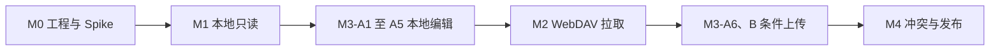

# BearObs 开发计划

> 文档状态：执行中（计划基线已确认）
> 版本：1.5
> 基线日期：2026-07-28
> 最近状态更新：2026-08-28
> 上游文档：[产品需求](01-product-requirements.md) · [技术路线](02-technical-roadmap.md) · [开发设计](03-development-design.md)

## 1. 计划目标

按严格依赖顺序交付：

```text
工程与安全基线
  -> 本地只读纵切
  -> 本地原始编辑与原子保存
  -> WebDAV 拉取技术预览
  -> 条件上传
  -> 冲突处理与发布加固

首发平台为 macOS；iOS 客户端不进入 M0-M4 的发布关键路径，只复用已验证的核心模块。
```

UI 可以在阶段内并行，但任何远端写能力不得越过本地原子写、同步基线和冲突决策质量门槛。

## 2. 估算假设

以下是工作量基线，不是未经验证的交付承诺：

- 团队基线：2 名有 SwiftUI、AppKit 和并发经验的 macOS 工程师；
- 兼职支持：产品/设计、QA 和安全评审；
- 工作量：约 11-14 工程师周；
- 关键路径日历时间：约 9-12 周；
- 单人开发预计约 14-18 周；
- M0 Spike 结束后根据 WebDAV 服务、中文搜索和 Markdown 渲染结果重新估算。

不包含：

- App Store 审核等待；
- 大规模视觉品牌设计；
- 未列入 MVP 的功能；
- 多个 WebDAV 厂商的认证成本。

## 3. 里程碑总览

| 里程碑 | 目标 | 预计工作量 | 发布形态 | 执行状态 |
|---|---|---:|---|---|
| M0 | Mac 工程与风险基线 | 1-1.5 工程师周 | 内部构建 | 完成：11 项完成，M0-11 移交 M2-A6 |
| M1 | Mac 本地只读闭环 | 2.5-3 工程师周 | 内部 P0 | 完成：C1-C8 已闭合，本地 Obsidian Vault 可作为只读笔记来源 |
| M2 | Mac WebDAV 拉取 | 2.5-3 工程师周 | 技术预览 | 延期：在本地编辑闭环后恢复 |
| M3 | Mac 编辑与条件上传 | 3-4 工程师周 | MVP 候选 | 进行中：A1-A5 本地编辑闭合，REQ-002 原位编辑 P0-P6 完成；上传未开始 |
| M4 | Mac 冲突与发布加固 | 2-3 工程师周 | 对外 Mac MVP | 未开始 |

M0 到 M4 是串联质量门。阶段内可并行的任务会明确标注。

### 3.1 当前执行位置

| 项目 | 当前状态 |
|---|---|
| 当前里程碑 | M3：Mac 本地编辑纵切（A1-A5 完成）；REQ-002 原位编辑 P0-P6 完成 |
| 当前进行中 | REQ-002 人工 VoiceOver 走查（清单待执行填写） |
| 最近完成 | REQ-002 P6/P7：键盘入口、VoiceOver 朗读、保存失败重试、深色与最大辅助字号验收，门禁全绿与安全审查（2026-10-01） |
| 下一计划项 | M3-C1：将生产原子写系统调用抽成故障注入接缝，覆盖磁盘/同步/rename 故障矩阵 |
| 退出阻塞 | 无；坚果云真实认证和分页协议不阻塞本地只读或本地编辑。REQ-002 状态变更不受阻于 M3 里程碑推进，仅受人工 VoiceOver 走查约束 |
| 里程碑验收 | M0、M1 已完成；M2 依产品顺序延期 |

状态含义：

- `完成`：产出已落库，并有与工作项相称的验证证据；
- `进行中`：已经开始，但产出或验证尚未闭合；
- `阻塞`：缺少外部条件、授权或前置决策，当前不能闭合；
- `未开始`：尚无实现证据；
- `下一步`：当前建议开始的工作项，不代表已经开工。

每次完成或切换计划项时，必须同时更新本节、对应工作项状态和证据。代码存在但验证
未完成时不得标记为完成。

## 4. 开发方法

### 4.1 TDD 循环

每个行为按以下顺序完成：

1. **RED**：先写能表达需求的失败测试；
2. **GREEN**：实现最小代码使测试通过；
3. **REFACTOR**：消除重复和特殊情况；
4. **VERIFY**：运行相关单元、集成、契约或 UI 测试；
5. **REVIEW**：检查正确性、安全、兼容性和范围。

测试应固定外部行为和领域契约，不绑定私有函数结构。

### 4.2 统一质量门

每个里程碑必须满足：

- 新行为有编号需求和可执行验收标准；
- 编译零 error，关键 warning 为 0；
- 全量单元和集成测试通过；
- 阶段关键 E2E 通过；
- 核心领域与同步逻辑行、分支覆盖率均不低于 80%；
- 代码审查无 Critical/High 问题；
- 日志不含正文、凭据和认证头；
- 文档与实现同步；
- 涉及写入时，原子性、幂等性、可恢复性和无静默覆盖已有证据。

## 5. M0：工程与风险基线

### 5.1 目标

建立独立、可测试的项目，并用最小 Spike 关闭高风险技术假设。

### 5.2 工作项

| ID | 工作项 | 产出 | 状态 | 证据或缺口 |
|---|---|---|---|---|
| M0-01 | 将 `bearobs` 初始化为独立 Git 仓库 | 独立历史和分支边界 | 完成 | 独立 `.git`、`main` 分支；`git rev-parse --show-toplevel` 返回 `/Users/ivows/workspace/bearobs` |
| M0-02 | 创建 macOS 15+ SwiftUI/AppKit 工程 | App、Unit Test、UI Test targets | 完成 | `BearObs.xcodeproj`、共享 scheme、三个 targets；Unit Test target 已通过 `build-for-testing` |
| M0-03 | 建立 CI | build、test、coverage、静态检查 | 完成 | `.github/workflows/ci.yml`、`scripts/ci/` 和 `Makefile` |
| M0-04 | 建立依赖和配置管理 | 锁定版本、无硬编码秘密 | 完成 | `.xcode-version`、`Config/`、零第三方运行时依赖、工作树及全 Git 历史秘密扫描 |
| M0-05 | 建立 Golden Vault | 兼容性和性能 fixture | 完成 | 13 个 parser case、1 MiB 大文件、256 个小文件；`make check` 与 test bundle 资源复制验证通过 |
| M0-06 | 建立可控 WebDAV fixture | PROPFIND、GET、PUT、412 和故障注入 | 完成 | 6 个合成资源、Depth:1 `207` golden、11 个 XCTest 契约、9 个故障/协议场景；`make check` 行为验证、`build-for-testing` 与 test bundle 资源复制通过 |
| M0-07 | Spike GRDB/FTS5 | migration、异步访问、10k 基线 | 完成 | 隔离 SwiftPM Spike 锁定 GRDB 7.11.1；7 个测试覆盖 v1→v2 回填、幂等、事务回滚、并发 async 读写、FTS 更新与 `unicode61`；10k Release 写入 2.855～3.204 秒、搜索 P95 0.302～0.330 毫秒；源码行覆盖率 99.02%，macOS arm64 交叉编译通过 |
| M0-08 | Spike Markdown | AST、Frontmatter、标签、Wiki Link、渲染 | 完成 | 隔离 SwiftPM Spike 锁定 swift-markdown 0.8.0 与 Yams 6.2.2；14 个 XCTest 覆盖 AST、只读 Frontmatter、标签/链接/Embed 排除与转义、Golden Vault 契约预期、无效 UTF-8、BOM/换行和性能；源码行覆盖率 93.74%，macOS arm64 交叉编译通过 |
| M0-09 | Spike 原子文件写 | 崩溃和磁盘失败测试 | 完成 | 隔离 SwiftPM Spike 以稳定父目录 descriptor、同目录 exclusive staging、`fsync`、mode 保留、inode 核对、单次 `rename` 和父目录同步替换已有文件；15 个 XCTest 覆盖 ENOSPC、短写/EINTR、权限、sync/close/rename、提交后错误、符号链接、字节保留及四类路径竞争；独立进程验证 7 个 SIGKILL 阶段；region 87.04%、line 94.88%，macOS arm64 交叉编译通过 |
| M0-10 | 冻结领域模型 | VaultPath、SyncDecision、错误模型 | 完成 | App Domain 冻结已解码/百分号路径双入口、NFC 身份、只解码一次和 Codable 重校验；纯 `SyncPlanner` 区分 tracked/initialImport/conservativeRecovery，破坏性计划携带 CAS，缺失可靠写前置条件永不 upload；强 ETag 从完整响应头解析，内容身份与写保护条件分离；错误恢复动作由 11 类错误唯一派生，诊断仅白名单结构字段；22 个 host XCTest 通过，region 98.89%、line 99.44%，Xcode test bundle 与 macOS arm64 交叉编译通过 |
| M0-11 | 认证首个服务 | 坚果云真实 WebDAV 本机人工验证 | 延期（移交 M2-A6） | 验证工具及安全边界已经建立，117 个离线 XCTest 通过；真实验证未执行，分页协议未文档化。该缺口不再阻塞 M0/M1，但任何真实服务发布和远端写仍受其约束 |
| M0-12 | 编写 ADR-001 至 ADR-007 | 可追溯决策 | 完成 | ADR-001～007 已写入；ADR-006 已接受服务选择，坚果云认证能力完整移交 M2-A6 |

### 5.2.1 M0-11 移交 M2-A6：本机一次性人工验证流程

M0-11 不按“完成”处理，而是完整移交 M2-A6；这项顺序调整只解除其对本地只读 M1 的阻塞，
不降低任何远端能力的安全门槛。该流程仅供 macOS 本机人工显式触发。真实坚果云访问不得进入 CI、XCTest、定时任务或常规
`check`/`test` 目标。固定 endpoint 为 `https://dav.jianguoyun.com/dav/`，凭据只存入 macOS
Keychain：service 固定为 `com.bearobs.m0-11.jianguoyun`，account 固定为 `credentials-v1`。
用户名和第三方应用密码放入版本化 `kSecValueData`，真实用户名不得进入 Keychain 元数据。
当前一次性 SwiftPM CLI 使用当前用户的登录钥匙串；所有操作固定到同一 Keychain 实现，不与
Data Protection/iCloud Keychain 混查或混删。未来迁移到签名 app-like bundle 时必须另起 ADR。

人工流程和边界：

1. 人工创建专用空目录和 BearObs 专用第三方应用密码；禁止使用真实 Vault，禁止开启终端录制、
   HAR 或 HTTP 代理抓包。
2. 通过 `store-credentials` 交互输入用户名和关闭回显的应用密码。用户名、密码和专用目录禁止
   通过 argv、环境变量、配置文件或 stdin 重定向传递，也不得进入 Shell 历史、日志、报告、
   artifact 或 Git。重复 Keychain 条目必须人工确认后才能替换。
3. 通过 `verify` 交互输入专用目录。先用独立 ephemeral session 验证未认证 Depth 0
   `PROPFIND` 返回 `401`，再响应固定 origin 的 Basic/Digest challenge，验证 Depth 0/1 `207`。
   工具必须先证明目录为空；非空或边界不明时零写入退出。
4. 只创建本次运行登记的合成 Markdown，覆盖 Unicode、空格和字面 `%` 路径，并验证 GET 字节、
   强 ETag、匹配 ETag 条件 PUT、旧 ETag 的条件 PUT/DELETE 均返回 `412`，且两次 `412` 后远端
   正文和当前强 ETag 不变。
5. mutation 前记录 intent；条件 DELETE 探针通过后，成功或失败都只按本次清单和刚证明的当前
   强 ETag 逐项 DELETE 并确认消失。禁止递归删除专用根，
   禁止扫描后批量删除，禁止删除未由当前运行登记的资源。崩溃恢复账本必须在仓库外以 `0700`
   目录和 `0600` 文件保存，并区分“仅登记”与“已验证条件 DELETE、允许清理”状态；探针通过前
   崩溃时只允许读取确认资源不存在，登记资源仍存在或状态不一致时停止自动删除并转人工复核。
6. 仅接受系统默认 TLS 信任和正确主机名，拒绝所有 HTTP redirect；跨 origin、HTTPS 降级、
   越出 `/dav/` 或专用根、带 userinfo/query 的 URL，以及越界 PROPFIND `href` 一律失败且不得携带
   凭据。
7. 报告只允许 case、`PASS`/`FAIL`/`BLOCKED`/`UNAVAILABLE`、HTTP 状态码、固定原因码、时间戳、
   工具版本、ETag 类别、字节/hash 结果和清理状态；不得包含 URL、用户名、密码、目录、对象名、
   认证 challenge/realm、正文、原始 ETag、Keychain 查询、HAR、截图或终端录制。需要时通过
   `delete-credentials` 删除固定 Keychain 条目。

坚果云没有文档化超过 750 条目的分页协议。不得臆造厂商私有 API，也不得发出 751 次 PUT 制造
数据；该项固定报告 `BLOCKED vendor-pagination-protocol-undocumented`。真实人工执行与脱敏证据审查
完成前，M2-A6 保持 `NO-GO`；即使其余 case 通过，分页仍为 `BLOCKED` 时也不得发布坚果云 profile
或开放远端写。它不阻塞 M1；取得厂商协议证据或通过新 ADR 调整服务能力边界后再关闭。

### 5.3 Golden Vault 内容

至少包含：

- YAML 字符串和数组标签；
- Inline Tag 和嵌套标签；
- 代码块中的伪标签；
- 同名笔记和显式路径 Wiki Link；
- Unicode、空格和百分号路径；
- 本地图片和缺失附件；
- 大文件和大量小文件；
- 无效 Frontmatter；
- UTF-8 BOM、LF 和 CRLF；
- 不支持的 Obsidian 语法。

不得使用用户真实 Vault。

### 5.4 退出条件

- Debug 和 Release 构建通过；
- CI 可重复运行；
- 至少一个领域测试完成 RED 到 GREEN；
- 路径越界测试通过；
- 原子替换故障测试通过；
- GRDB、Markdown 和 FTS Spike 有明确结论；
- 首个真实 WebDAV 认证服务已选定，验证工具和安全边界已有离线证据；真实服务验证明确移交 M2-A6，完成前不暴露任何远端能力；
- 没有进入业务实现的未决致命架构问题。

## 6. M1：本地只读纵切

### 6.1 目标

在无网络条件下完成“枚举、索引、查找、阅读”的有用闭环。

### 6.2 工作流 A：Vault 与解析

| ID | 工作项 | 依赖 | 状态 | 证据或缺口 |
|---|---|---|---|---|
| M1-A1 | 实现 VaultPath 和本地枚举 | M0-10 | 完成 | `LocalVaultEnumerator` 使用 descriptor-relative `openat`、`fstatat` 和 `O_NOFOLLOW` 流式递归；排除保留目录和非 Markdown，跳过文件/目录符号链接，NFC `VaultPath` 确定排序；6 个 XCTest 覆盖 Golden Vault 272 个 Markdown、Unicode/空格/字面 `%`、根边界和 visitor 失败；region 86.15%、line 92.31%，SwiftPM 28 测试与 macOS host `build-for-testing` 通过 |
| M1-A2 | 实现 Frontmatter 只读解析 | M0-08 | 完成 | 独立 `BearObsMarkdown` 模块锁定 Yams 6.2.2；按原始 `Data` 识别精确分隔线、UTF-8 BOM、LF/CRLF，输出正文 byte range；只读取 YAML `title` 与字符串/数组 `tags`，无效 YAML 和未闭合 Frontmatter 返回固定结构化诊断且正文仍可读；7 个 XCTest 覆盖 Golden Vault、空/缺失 Frontmatter、无效 UTF-8和字节不改写；SwiftPM 全量 35 测试通过，parser region 88.64%、line 96.46%，Xcode macOS host SDK 下 App、Yams 与 Unit Test targets 编译链接通过 |
| M1-A3 | 实现标准 Markdown AST | M0-08 | 完成 | 正式 `BearObsMarkdown` 精确锁定 swift-markdown 0.8.0；`MarkdownASTParser` 只消费 M1-A2 的正文 byte range，返回正文相对 `Document` 与原文映射范围，不重新识别 Frontmatter；7 个 XCTest 覆盖标准节点、链接/图片、源码位置、空正文、有效/无效/未闭合 Frontmatter、BOM/CRLF/Unicode 及 Obsidian 扩展原文降级；SwiftPM 全量 42 测试通过，parser region/line 100%，macOS Release 交叉编译及 Xcode App、Unit Test targets 编译链接通过；独立审查无 actionable findings，未混入 M1-A4 扫描、HTML 或 UI |
| M1-A4 | 实现标签、Wiki Link 和 Embed 扫描 | M1-A2、M1-A3 | 完成 | `ObsidianSyntaxScanner` 只消费与 AST 同源的正文数据，以 AST 范围遮罩代码、标准链接目标、图片和 HTML，再线性扫描 Inline Tag、Wiki Link 与 Embed；每次 occurrence 保留原始 source 及原笔记 UTF-8 半开 byte range，不在语法层去重或解析路径；13 个 XCTest 覆盖 Golden Vault、链接可见文字、代码/URL/HTML 排除、奇偶转义、标签边界、BOM/CRLF/Unicode、Frontmatter 降级、重复/空/跨行/未闭合 token；SwiftPM 全量 55 测试通过，scanner region 94.44%、line 96.71%，macOS Release 交叉编译及 Xcode App、Unit Test targets 编译链接通过；平方级未闭合 token 搜索和范围 fail-open 已在审查中消除 |
| M1-A5 | 实现标题、摘要和解析诊断 | M1-A4 | 完成 | `MarkdownNoteParser` 成为唯一公开生产解析入口，在 UTF-8/YAML/AST 前执行已由 Golden 基线验证的 1 MiB note byte limit；Yams 前再执行 64 KiB Frontmatter 及 libyaml event 级 depth/node/alias 预算，扫描和聚合阶段限制 Frontmatter tags、语法 occurrence、单 token bytes 与唯一标签。标题固定为 Frontmatter、首个顶层 ATX H1、文件名 stem 三段优先级，摘要取正确标题边界后的首个顶层语义段落并流式截到 200 个 Character；Frontmatter 与正文标签按 NFC、固定 locale 大小写身份稳定合并，同时原始 A4 occurrence/range 不变。22 个新 XCTest 覆盖优先级、结构去除、转义/代码语义、YAML merge、Unicode、诊断、对抗性资源边界和 Golden 集成，SwiftPM 全量 77 测试通过；parser region 88.17%、line 95.08%，相关生产文件总 region 92.81%、line 96.53%，`make check` 和 macOS Release 交叉编译通过；独立安全复审无 actionable finding；本机无可用 Mac UI 运行环境，最终 Xcode scheme 重跑保留为已记录的基础设施缺口 |

### 6.3 工作流 B：索引与搜索

| ID | 工作项 | 依赖 | 状态 | 证据或缺口 |
|---|---|---|---|---|
| M1-B1 | 建立 `index.sqlite` migrations | M0-07 | 完成 | 正式 `BearObsIndex` 精确锁定 GRDB 7.11.1；v1 建立 notes、tags、note_tags、links、attachments 及约束/索引，v2 建立 FTS5 `unicode61` 并回填旧行；7 个 XCTest 覆盖新库、磁盘重开幂等、v1→v2 回填、迁移失败不误记、外键级联、状态/range 约束和重复 occurrence 保真；源码 region/line 100%，SwiftPM 全量 84 测试、`make check` 与 macOS arm64 Release 交叉编译通过；本机缺 可用 macOS UI 测试运行环境，Xcode scheme build/test 仍为基础设施缺口 |
| M1-B2 | 实现单文件事务索引 | M1-A5 | 完成 | `IndexNoteInput` 冻结解析结果与文件属性；单事务替换 notes、tags、occurrence 与双 FTS，删除和失败降级同样原子；故障 trigger 验证整笔回滚，标签展示名可确定性重算 |
| M1-B3 | 实现增量扫描和 hash 跳过 | M1-B2 | 完成 | descriptor-relative `LocalVaultStore` 不跟随符号链接，单次读取流式 SHA-256；路径/size/mtime 快筛，同 hash 只刷新元数据，变更才解析，超限或非法 UTF-8 保留安全标题 |
| M1-B4 | 实现 FTS5 查询和排序 | M1-B2 | 完成 | 查询 NFC/空白规范化，256 字符与 1...100 limit 硬边界，全量参数绑定；bm25 权重 title 10、tags 5、body 1，空查询按最近修改时间返回 |
| M1-B5 | 实现全量重建 | M1-B3 | 完成 | 在单个写事务内逐篇读取、解析和替换，峰值内存按单篇上限有界；与增量结果一致，注入中途失败时旧索引保持可搜索 |
| M1-B6 | 验证中文搜索策略 | M1-B4 | 完成 | ADR-008：6 个正向查询由裸 `unicode61` 2/6 提升为 6/6，2 个负向组合查询无测得误匹配；10,000 篇 P95 0.808 ms，FTS 页占用 3.44 倍；v4 流式回填，纯汉字 phrase 保持相邻语义 |

### 6.4 工作流 C：只读 UI

| ID | 工作项 | 依赖 | 状态 | 证据或缺口 |
|---|---|---|---|---|
| M1-C1 | Library 列表和状态 | M1-B2 | 完成 | `libraryNotes()` 返回不可变摘要并按修改时间/路径稳定排序；`LibraryFeatureModel` 明确建模 loading、indexing、content、empty、failure，失败文案不透传底层错误，刷新失败保留旧列表，竞态由 operation ID 拒绝旧结果；SwiftUI 展示标题、摘要、相对时间和非纯颜色解析状态；7 个新测试、SwiftPM 全量 115 测试通过，全量生产源码 region 86.31%/line 89.05%，核心逻辑 region 92.13%/line 96.87%；App 壳完成 macOS host 与 macOS arm64 Release 交叉编译 |
| M1-C2 | 标签导航 | M1-B2 | 完成 | `libraryTags()` 从 tags/note_tags 返回稳定展示名和计数，`libraryNotes(taggedWith:)` 参数绑定精确筛选并复用 Library 排序/摘要；主侧边栏标签树、中栏固定笔记列表、空态、错误、刷新失败保留旧结果和精确标签笔记查询均通过 Feature Model 隔离；7 个新测试、SwiftPM 全量 122 测试通过，全量生产源码 region 83.77%/line 85.66%，核心逻辑 region 92.00%/line 96.95%；App 壳 macOS arm64 Release 交叉编译通过 |
| M1-C3 | 搜索和摘要 | M1-B4 | 完成 | `SearchFeatureModel` 只消费现有搜索端口，明确建模 loading/content/empty/failure；operation ID 拒绝过期结果，结构化取消恢复稳定状态，错误只显示固定文案；SwiftUI 搜索页复用最近笔记、普通/CJK FTS 排序和有界摘要，不加载正文；3 个新状态机测试，SwiftPM 全量 125 测试通过，全量生产源码 region 81.86%/line 83.27%，核心逻辑 region 91.77%/line 96.91%，Search model line 97.14%；App 壳 macOS arm64 Release 交叉编译通过 |
| M1-C4 | Markdown Reader | M1-A3 | 完成 | `ReaderDataSource.localVault` 按规范路径在独立 actor 读取并复用统一 parser；闭合 block/inline 模型支持标题、段落、强调、粗体、删除线、列表/任务、引用、行内/块代码和安全标准链接，HTML/未知/Obsidian 语法安全显示原文；Library、Tags、Search 均可进入 Reader；6 个新解析/状态/离屏渲染测试，SwiftPM 全量 132 测试通过，全量生产源码 region 80.81%/line 81.56%，核心逻辑 region 90.46%/line 96.47%；App 壳 macOS arm64 Release 交叉编译通过 |
| M1-C5 | Wiki Link 跳转 | M1-A4、M1-C4 | 完成 | 扫描结束后批量按显式路径、源目录、Vault 根、唯一文件名的固定优先级解析 occurrence；歧义、缺失和非法路径不猜测；Reader 按原始 UTF-8 range 精确合并解析结果，仅 resolved 的规范 `VaultPath` 生成受限内部路由并复用同一 Reader source 递归导航；新增 7 个解析、持久化、重复 occurrence、路由安全和真实扫描到 Reader 集成测试，SwiftPM 全量 139 测试通过，全量生产源码 region 81.20%/line 82.56%；`make check` 与 macOS arm64 Release 交叉编译通过 |
| M1-C6 | 本机收藏 | M1-C1 | 完成 | `FileUserStateStore` 原子持久化 `Metadata/user-state.json`，`AppEnvironment` 将 `Files/`、`Metadata/index.sqlite`、索引扫描器和用户状态仓储组装为唯一生产组合根；Library、Tags、Search、Favorites、Recent 和 Reader 共享同一 `FavoritesFeatureModel`，Reader 首次进入即加载持久化状态，星标更新失败保留旧状态并显示固定文案；空查询复用索引最近修改排序。并发旧写入完成后会按最新意图补偿，避免内存/磁盘分裂；Reader 在收藏状态就绪前禁用按钮。SwiftPM 全量 176 测试通过，Reader/Favorites/Recent 离屏渲染和真实本地 Reader 集成通过，`swift-format lint --strict`、`git diff --check`、pbxproj 校验和 arm64 macOS Release 交叉编译通过。 |
| M1-C7 | macOS VoiceOver、键盘导航、深色模式 | M1-C1 至 C6 | 完成 | 主工作区采用 macOS 原生可收缩三栏：资料库导航、笔记列表和阅读详情分离，左栏保留笔记/最近/收藏/标签/搜索，中栏保持选择状态，右栏只渲染选中笔记；Library/Search 标题、日期和摘要不截断；Reader 标题暴露 H1-H6，装饰元素不进入 VoiceOver；外链和 resolved Wiki Link 在 macOS AX 树中均暴露为独立 link，引用正文独立可读，任务项朗读“已完成/未完成”，收藏按钮随状态朗读“收藏/取消收藏”，代码区提供 `Scroll Left/Right` 且滚动值可由 0→1；浅/深色离屏矩阵、普通键盘导航和 macOS UI 启动/主导航冒烟均通过。VoiceOver 操作不属于本项目用户要求，因此不作为退出条件。 |
| M1-C8 | 选择并加载本地 Obsidian Vault | M1-A1 至 C7 | 完成 | 首次启动显示可访问的“打开 Vault…”入口，macOS 原生目录选择器只接受目录；选择后使用 security-scoped bookmark 持久化并在下次启动恢复。每次选择使用独立 UUID，在 `Application Support/BearObs/Vaults/<UUID>/Metadata` 保存 `index.sqlite` 与 `user-state.json`；用户 Vault 始终只读，切换 Vault 不会复用旧索引或收藏。选择状态文件拒绝目录/文件符号链接、非普通文件、超限和无效数据，持久化为原子写入且权限为 `0600`。4 个 XCTest 覆盖空状态、bookmark 创建/恢复、存储 round-trip 和选择文件符号链接拒绝；macOS Debug 构建与专项测试通过。 |

工作流 A、B、C 在接口冻结后可并行，但 C 不得绕过应用用例直接访问 SQLite。

### 6.5 测试

- parser golden tests；
- VaultPath 属性和边界测试；
- 索引事务、删除和重建集成测试；
- FTS 标题、正文和标签测试；
- 同名链接解析测试；
- 10,000 文件性能测试；
- 本地 Vault 选择、bookmark 恢复和无效选择状态测试；
- 离线列表、搜索、阅读 macOS UI 自动化测试。

### 6.6 退出条件

- AC-01 通过；
- 断网可浏览、搜索和阅读；
- 删除 `index.sqlite` 后重建结果一致；
- 任何只读流程都不修改 Vault 字节；
- 满足 PRD 本地性能预算；
- 中文搜索策略已有实测决策；
- 可选择并在重启后恢复本地 Obsidian Vault；
- 形成内部 P0。

## 7. M2：WebDAV 拉取技术预览

### 7.1 目标

可靠建立和维护本地工作副本，暂不开放远端写入。

### 7.2 工作流 A：连接与远端协议

| ID | 工作项 | 依赖 |
|---|---|---|
| M2-A1 | HTTPS URL 和 Vault 路径验证 | M0-10 |
| M2-A2 | Keychain 凭据封装 | M2-A1 |
| M2-A3 | PROPFIND Depth:1 和 Multi-Status 解析 | M0-06 |
| M2-A4 | GET 流式下载 | M2-A3 |
| M2-A5 | 能力探测和错误分类 | M2-A3 |
| M2-A6 | 真实服务认证测试 | M2-A3 至 A5 |

### 7.3 工作流 B：同步账本与拉取

| ID | 工作项 | 依赖 |
|---|---|---|
| M2-B1 | 建立独立 `sync.sqlite` | M0-10 |
| M2-B2 | 实现本地、远端和基线快照 | M2-A3、M2-B1 |
| M2-B3 | 实现纯 SyncPlanner | M2-B2 |
| M2-B4 | 实现首次下载 | M2-A4、M2-B3 |
| M2-B5 | 实现增量修改和新增下载 | M2-B4 |
| M2-B6 | 实现远端删除和重命名接收 | M2-B5 |
| M2-B7 | 实现取消、重试和崩溃恢复 | M2-B4 至 B6 |

### 7.4 工作流 C：附件与前台体验

| ID | 工作项 | 依赖 |
|---|---|---|
| M2-C1 | 远端附件元数据 | M2-A3 |
| M2-C2 | 按需附件下载 | M2-A4、M2-C1 |
| M2-C3 | 50 MB 上限和有界缓存 | M2-C2 |
| M2-C4 | 连接、进度和同步状态 UI | M2-B4 |
| M2-C5 | 启动、前台和手动触发 | M2-B4 |
| M2-C6 | 后台调度尽力同步 | M2-C5 |

M2-A 和 M2-B1 可并行；M2-C6 最后做，不能让后台调度干扰确定性前台流程。

### 7.5 测试

- WebDAV fixture 契约测试；
- Unicode 和恶意路径测试；
- TLS、认证、重定向和日志脱敏测试；
- 网络中断、重试和限速测试；
- 远端新增、修改、删除、重命名集成测试；
- 附件缓存上限和清理测试；
- 至少一个真实服务的认证矩阵。

### 7.6 退出条件

- AC-02、AC-03 和拉取部分 AC-06 通过；
- 网络中断后可恢复；
- 远端变化不覆盖本地未同步内容；
- RFC fixture 和一个真实服务通过；
- 凭据和正文不进入日志；
- 形成拉取型技术预览。

## 8. M3：编辑与条件上传

### 8.1 目标

开放最小但完整的写路径：编辑已有 Markdown、本地原子保存、条件上传。

### 8.2 工作流 A：本地编辑

| ID | 工作项 | 依赖 |
|---|---|---|
| M3-A1 | 原始 Markdown 编辑器 | M1-C4 |
| M3-A2 | 脏状态和离开保护 | M3-A1 |
| M3-A3 | BOM 和换行保留 | M0-09 |
| M3-A4 | Staging 和原子替换 | M0-09 |
| M3-A5 | 保存后增量索引 | M3-A4、M1-B2 |
| M3-A6 | 待同步状态 | M3-A4、M2-B1 |

M3-A1 至 A5 已完成本地纵切：只编辑已有 `.md`，保存使用原始文本、expected-hash CAS、
macOS 文件协调、同目录 staging/原子替换和提交结果分级；保存后仅在一个事务中更新当前笔记及其
Wiki Link。200 个 SwiftPM XCTest 全绿，Xcode App 覆盖率 82.40%，Debug/Release 构建通过。
M3-A6 与全部远端上传工作仍未开始；M3-C1 的生产 writer 故障注入是下一道写路径门禁。

在 A1-A5 之上，REQ-002 原位编辑（实现计划 P0-P7，2026-09-28 至 2026-10-01）完成编辑表面
重建：ADR-009 决策边界与 UI 测试状态隔离、投影与 UTF-8↔UTF-16 坐标映射、编辑会话状态机、
单一 AppKit 源码保真编辑表面、任务 marker 与局部源码交互、阅读/编辑位置连续性、键盘与
VoiceOver 与失败路径验收。收口门禁（2026-10-01）：SwiftPM 345 测试、xcodebuild 测试计划
382 测试（含 7 条 UI）全绿，覆盖率 85.04%，Debug/Release 构建通过，写路径安全审查无发现；
执行记录见 `docs/requirements/REQ-002-implementation-plan.md`。人工 VoiceOver 走查
（`docs/requirements/REQ-002-voiceover-checklist.md`）完成前 REQ-002 保持 `confirmed`，
不标记 `completed`。

### 8.3 工作流 B：条件上传

| ID | 工作项 | 依赖 |
|---|---|---|
| M3-B1 | PUT 契约实现 | M2-A6 |
| M3-B2 | `If-Match` 和 412 处理 | M3-B1 |
| M3-B3 | local-only 上传 action | M3-A6、M2-B3 |
| M3-B4 | 上传期间本地再修改处理 | M3-B3 |
| M3-B5 | 新 validator 和基线提交 | M3-B3 |
| M3-B6 | 有界重试和退避 | M3-B3 |

### 8.4 工作流 C：安全验证

| ID | 工作项 | 依赖 |
|---|---|---|
| M3-C1 | 原子写故障注入 | M3-A4 |
| M3-C2 | 双边变化冲突创建 | M3-B2 |
| M3-C3 | 未编辑区域字节保留测试 | M3-A4 |
| M3-C4 | 无 ETag 服务降级验证 | M3-B2 |
| M3-C5 | 写路径安全评审 | M3-A、M3-B |

本地编辑 UI 可以与 PUT 实现并行，但集成前必须由 SyncPlanner 和原子写测试先给出可执行契约。

### 8.5 测试

- LF、CRLF、BOM 和异常 Frontmatter 保存；
- 磁盘不足、文件替换中断和 App 终止；
- local-only、remote-only、both-changed 状态矩阵；
- 412、超时、5xx 和上传后本地再修改；
- 保存、离线、网络恢复和上传 macOS UI 自动化；
- 未编辑内容 byte-preservation golden test。

### 8.6 退出条件

- AC-04 和完整 AC-06 通过；
- local-only 可条件上传；
- remote-only 可安全下载；
- both-changed 必定创建冲突；
- 写失败不破坏上一个完整文件；
- 未编辑 Frontmatter 和换行不被无关改写；
- 写路径安全评审无 Critical/High；
- 形成 MVP 候选。

## 9. M4：冲突处理与发布加固

### 9.1 目标

完成冲突闭环并达到公开 MVP 的安全、性能和可用性标准。

### 9.2 工作项

| ID | 工作项 | 产出 |
|---|---|---|
| M4-01 | 冲突目录和生命周期 | 双方副本不可丢失 |
| M4-02 | 冲突列表和详情 | 可发现、可理解 |
| M4-03 | 保留本地 | 带二次条件检查 |
| M4-04 | 保留远端 | 本地安全替换 |
| M4-05 | 手工合并 | 新内容再次条件上传 |
| M4-06 | 二次冲突 | 解决期间远端变化仍不覆盖 |
| M4-07 | 索引和账本恢复演练 | 可恢复性证据 |
| M4-08 | 性能和内存优化 | 满足 NFR-03 |
| M4-09 | 辅助功能验收 | VoiceOver、Dynamic Type、深色模式 |
| M4-10 | 隐私和安全审查 | 无高危问题 |
| M4-11 | Mac Beta/发布 验收 | 发布候选 |
| M4-12 | 发布文档和支持说明 | 已知限制、恢复说明 |

### 9.3 测试

- AC-05 和 AC-07；
- 冲突三种解决方式；
- 解决期间远端二次变化；
- 索引损坏、账本损坏和 staging 残留；
- 10,000 Markdown / 2 GB 附件性能；
- 全量关键 macOS UI 自动化；
- 安全、隐私和辅助功能审查；
- 长时间同步和前后台切换稳定性。

### 9.4 退出条件

- PRD AC-01 至 AC-07 全部通过；
- 静默覆盖路径为 0；
- 核心逻辑行和分支覆盖率均不低于 80%；
- Critical/High 安全问题为 0；
- 一个真实 WebDAV 服务通过发布认证矩阵；
- 关键 E2E 全绿；
- Mac Beta/发布 验收通过；
- 形成对外 MVP。

## 10. M5：后续版本

M5 不阻塞 MVP，也不得偷塞进 M1-M4：

### V1.1

- App 内创建笔记；
- 安全删除和回收站；
- 重命名和链接更新策略；
- 更多 WebDAV 服务认证；
- 缓存策略可配置。

### V2

- Backlinks；
- Daily Note；
- 快捷创建；
- 跨设备收藏；
- 更完整的 Obsidian Embed 和链接语义。

### V3

- AI 语义搜索；
- 向量索引；
- RAG；
- 自动标签；
- 智能摘要。

V3 必须保持可关闭、可删除，不能改变 Markdown 事实源。

## 11. 关键依赖与并行策略



可并行：

- M1 中解析器、索引基础和只读 UI；
- M3-A1 至 A5 的原始编辑器、原子写和索引刷新；
- M2 中 WebDAV 客户端与同步账本基础；
- M3 的条件上传只在 M2 后实现；
- M4 中辅助功能、性能和发布文档。

不可并行绕过：

- 编辑上传不能早于拉取状态模型稳定；
- 条件 PUT 不能早于真实服务契约验证；
- 冲突 UI 不能替代冲突副本原子保存；
- 后台调度不能早于确定性前台同步；
- 发布不能早于故障注入和账本恢复演练。

## 12. 测试矩阵

| 层级 | 工具 | 每次 PR | 每日/阶段 | 发布前 |
|---|---|---:|---:|---:|
| 单元 | Swift Testing/XCTest | 是 | 是 | 是 |
| 数据库集成 | XCTest + 临时 DB | 是 | 是 | 是 |
| 文件系统集成 | XCTest + 临时目录 | 是 | 是 | 是 |
| WebDAV 契约 | 本地 fixture | 是 | 是 | 是 |
| 真实服务认证 | macOS 本机人工工具 + 专用空目录 | 否 | 阶段人工 | 发布前人工 |
| UI 关键流 | macOS UI 自动化 | 冒烟 | 是 | 是 |
| 性能 | XCTest metrics | 基准子集 | 是 | 是 |
| 故障注入 | 自定义适配器 | 关键子集 | 是 | 是 |
| 安全与依赖 | 静态检查/人工评审 | 是 | 是 | 是 |

真实服务认证行中的“阶段人工”不是自动化门：必须由开发者在本机显式触发，且不得读取 CI secret、
环境变量或自动执行。其输出仅保留 ADR-006 定义的脱敏能力矩阵。

## 13. 需求追踪

每个工作项需在任务系统中标注：

- PRD 需求编号，例如 FR-03；
- 验收标准编号，例如 AC-05；
- 所属里程碑；
- 测试层级；
- 数据或安全风险；
- 负责人与评审人；
- 阻塞依赖。

完成后必须能从 FR/AC 追到代码、测试和发布证据。

## 14. 风险登记

| 风险 | 概率 | 影响 | 缓解 | 触发点 |
|---|---|---|---|---|
| WebDAV 方言差异 | 高 | 高 | 适配器、能力探测、fixture 和真实服务矩阵 | M0/M2 |
| 静默覆盖 | 中 | 极高 | 三方比较、条件写、保留双方、故障注入 | M2-M4 |
| Markdown 被格式化 | 中 | 高 | 原文编辑、byte-preservation golden tests | M1/M3 |
| 中文搜索效果差 | 中 | 中 | M1 真实语料评测，按结果选择分词 | M0/M1 |
| 大 Vault 卡顿 | 中 | 高 | 流式枚举、增量索引、有界并发和缓存 | M1/M4 |
| macOS 后台调度不可靠 | 高 | 中 | 前台确定触发，后台仅优化 | M2 |
| 路径穿越或 URL 编码错误 | 中 | 极高 | 单一 VaultPath、同源和根目录校验 | M0/M2 |
| 真实验证凭据或路径泄漏 | 低 | 极高 | 固定 Keychain 条目、仅交互输入、严格脱敏、禁止 argv/env/抓包 | M0/M2 |
| 坚果云分页协议未文档化 | 高 | 高 | 不阻塞本地 M1；不臆造私有 API，能力矩阵明确 `BLOCKED`，取得厂商证据或新 ADR 前不发布坚果云 profile | M2 |
| 账本损坏 | 低 | 极高 | 与索引隔离、保守重建、恢复演练 | M2/M4 |
| 范围膨胀 | 高 | 中 | M5 隔离、阶段退出门 | 全程 |
| Bear 品牌相似 | 低 | 高 | 只借鉴交互，不复制资产 | M1/M4 |

## 15. 每周执行节奏

建议节奏：

- 周初：确认本周 FR/AC、风险和测试接缝；
- 开发中：小批量 RED-GREEN-REFACTOR，避免长分支；
- 每日：运行受影响测试和静态检查；
- 合并前：完整 diff、秘密和日志检查；
- 周末：阶段集成、性能趋势和风险登记更新；
- 里程碑末：退出评审，不通过则不进入下一写入级别。

## 16. 发布检查表

### 功能

- [ ] AC-01 至 AC-07 通过
- [ ] MVP 不含创建、删除和重命名入口
- [ ] 冲突三种解决方式通过
- [ ] 离线编辑和恢复通过

### 数据安全

- [ ] 静默覆盖路径为 0
- [ ] 原子写故障测试通过
- [ ] 412 和二次冲突通过
- [ ] 索引与账本分别恢复通过
- [ ] 冲突双方副本可恢复

### 安全与隐私

- [ ] 只允许 HTTPS 和系统信任证书
- [ ] 凭据只在 Keychain；M0-11 工具固定 service/account，禁止 argv/env/日志
- [ ] 路径穿越测试通过
- [ ] 日志无正文和凭据
- [ ] Critical/High 为 0
- [ ] 第三方许可证已审查

### 质量

- [ ] 核心行和分支覆盖率均达到 80%
- [ ] 全量单元、集成、契约和 UI 测试通过
- [ ] 10,000 Markdown 性能预算通过
- [ ] 2 GB 附件缓存行为通过
- [ ] VoiceOver、Dynamic Type 和深色模式通过

### 发布

- [ ] 首个真实 WebDAV 服务通过认证矩阵
- [ ] Mac Beta/发布 验收通过
- [ ] 隐私说明与实际数据行为一致
- [ ] 已知限制和恢复说明完成
- [ ] 版本号、迁移和回滚方案确认

## 17. 当前下一步

当前按依赖顺序推进 M1：

1. M1-B1 至 B6 已全部完成 RED、GREEN、VERIFY、REVIEW；`index.sqlite` 已具备迁移、事务写入、增量扫描、hash skip、有界查询、可回滚重建和实测中文检索；
2. M1-C1 已完成：Library 只消费不可变摘要和闭包端口，不直接访问 SQLite；加载、索引、内容、空态和失败均为互斥状态，旧异步结果不能覆盖新刷新；SwiftPM 全量 115 测试通过；
3. M1-C2 已完成：标签计数、筛选和主侧边栏导航继续复用同一仓储读边界与中栏笔记摘要模型，刷新失败保留旧标签、失效选择清空且旧异步结果不能覆盖新结果；SwiftPM 全量 122 测试通过；
4. M1-C3 已完成：搜索 Feature Model 负责查询取消、过期结果隔离和互斥结果状态，SwiftUI 只消费已有 `search()` 接口与有界摘要；SwiftPM 全量 125 测试通过；
5. M1-C4 已完成：Reader 从统一本地读取端口消费解析结果，标准 Markdown 转换为闭合渲染值，未知/危险内容安全降级，三个列表入口均可导航阅读；SwiftPM 全量 132 测试通过；
6. M1-C5 已完成：索引在扫描末尾批量消歧 Wiki Link，Reader 按精确 occurrence 消费解析结果；只有 resolved 的规范路径可跳转，缺失、歧义、非法和伪造内部 URL 均 fail closed；SwiftPM 全量 139 测试通过；
7. M1-C6 已完成：收藏事实只写 `Metadata/user-state.json`，索引仍是可重建派生数据；`AppEnvironment` 统一组装本地 Files、index.sqlite、扫描器和用户状态，空查询直接复用最近排序；SwiftPM 全量 176 测试通过，新增 Reader 收藏状态/写入失败、Favorites/Recent/Library/Reader 离屏渲染以及并发旧写入补偿覆盖；全量生产源码覆盖率约为 region 78.15%、line 78.25%，其中声明式 View 分支拉低总值，核心模型与基础设施维持项目既有 80% 质量门；
8. M1-C7 已完成：Library、Search、Tags、Reader 在浅色/深色矩阵离屏渲染通过；Reader 外链/Wiki Link 已有独立 AX link，引用、任务、收藏和横向代码滚动的 AX 语义已在 macOS Release 实例核验；普通键盘导航和 macOS UI 启动/主导航冒烟通过。按用户确认，VoiceOver 操作不作为本工作项的退出条件；
9. 坚果云验证工具保留，但不在 M1 期间主动执行。进入 M2 后由 M2-A6 接管真实认证、脱敏报告和分页决策。

每一步都必须单独完成 RED、GREEN、VERIFY、REVIEW。未通过当前工作项，不提前堆叠下一层概念。
